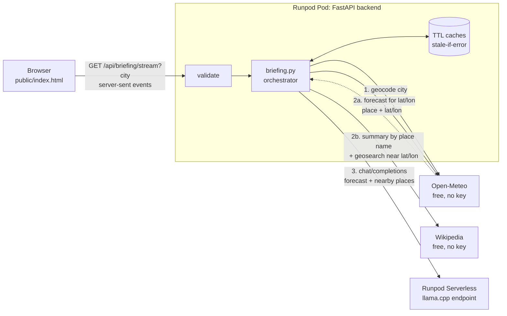

# City Briefing

Type a city and get a short briefing on what to do there today. The backend geocodes the city with **Open-Meteo**, then uses the resulting place and coordinates to fetch the forecast (Open-Meteo) and the city summary and **nearby landmarks** (**Wikipedia**). An LLM running on a **Runpod Serverless** endpoint (llama.cpp serving Qwen2.5-7B-Instruct) matches the landmarks to the forecast and writes the briefing, citing which facts came from which source.

**Stack:** Python 3.12 (FastAPI + httpx, served by uvicorn), a single static HTML/JS page for the frontend, pytest for tests. No auth, no database.

## Architecture



**The APIs are chained.** Open-Meteo's geocoder resolves the city to a place with coordinates. That output drives everything else: the forecast uses the coordinates; the Wikipedia summary is looked up by exact title ("Portland", then "Portland, Oregon", then "Portland, United States", then a search) and accepted only if the article's own coordinates are within 50 km of the geocoded point (so "Portland" lands on the right article, and a video game called "Cosmology of Kyoto" can't be mistaken for Kyoto); and Wikipedia's geosearch uses the same coordinates to list nearby landmarks. The LLM then matches those landmarks to the forecast (indoor options when rain is likely, outdoor when it is clear). The forecast and the two Wikipedia lookups don't depend on each other, so they run concurrently.

**Streaming.** `GET /api/briefing/stream` sends server-sent events: a `briefing` event with everything except the answer (so the cards show within a couple of seconds), then `delta` events as the model writes, then `done` (the cleaned final text) or `warning`. While the model is slow to start, a `: ping` comment goes out every 15s, which keeps Runpod's Pod proxy (it closes a connection that is silent for about 100s) from cutting a cold start short. Problems found before the first event (bad input, unknown city, Open-Meteo down) are ordinary JSON error responses. `GET /api/briefing` returns the same briefing as one JSON document and is handy for curl, but on a Pod it can hit the proxy limit during a cold start.

**Nearby places.** Wikipedia's geosearch returns anything with coordinates, so results are filtered to articles whose short description sounds like a place to visit (park, museum, castle, square...). It is a keyword heuristic: it drops police bodies and hospitals but can miss unusual sights.

**Ambiguous names.** "San Diego" matches places in California, Texas, Colombia and more. The backend asks the geocoder for up to 5 matches, uses the best-ranked one, and returns the rest as `alternatives` (id, name, region, country). The UI states which place it used and shows the others as "Not the right one?" chips. Clicking one repeats the request with `&id=<id>`, which looks the place up by its Open-Meteo id. Clients send only a numeric id, never coordinates or place names.

### API

| Route | What it does |
|---|---|
| `GET /api/briefing/stream?city=<name>[&id=<id>]` | The briefing as server-sent events (events below). Used by the page |
| `GET /api/briefing?city=<name>[&id=<id>]` | The same briefing as one JSON document (`answer` is `null` when the model step fails or is capped) |
| `GET /health` | `{"ok": true, "model": "<LLM_MODEL>"}` |

`city` is required unless `id` is given. Errors found before any briefing data exists are JSON: `{"error": "<plain-language message>", "code": "<code>"}` with status `400` (`bad_input`), `404` (`city_not_found`), `429` (`rate_limited`, with `Retry-After` when the upstream sent one), `502` (`unavailable`, `bad_response`), `504` (`timeout`) or `500` (`internal`).

### Project layout

| Path | What's there |
|---|---|
| `public/index.html`, `public/render.js` | The page (form, loading, error and warning states, streamed answer) and the pure Markdown and link rendering for the model's text |
| `app/main.py` | FastAPI wiring: routes, error handlers, static files |
| `app/briefing.py` | The workflow: `resolve_place` -> `fetch_forecast` -> `fetch_wikipedia` -> `generate_answer` |
| `app/weather.py`, `app/wikipedia.py`, `app/llm.py` | One module per upstream (Open-Meteo, Wikipedia, the LLM). URL building and response shaping are small pure functions |
| `app/stream.py` | Server-sent events and the keepalive |
| `app/http.py`, `app/errors.py` | httpx calls with a timeout and a `tenacity` retry; every failure becomes an `UpstreamError`, mapped to a status, body and headers |
| `app/cache.py`, `app/budget.py` | TTL cache that serves stale data on failure; global cap on LLM calls |
| `app/validate.py`, `app/config.py` | Input validation; environment config |
| `llama-cpp/` | Source of the container images for the LLM endpoint (see [llama-cpp/README.md](llama-cpp/README.md)) |
| `tests/`, `tests-js/` | Backend unit and end-to-end tests; frontend rendering tests |

## Environment variables

| Var | Default | Notes |
|---|---|---|
| `LLM_BASE_URL` | `http://localhost:11434/v1` | Any OpenAI-compatible base URL |
| `LLM_API_KEY` | `none` | Runpod API key. **Server-side only**; never sent to the browser or logged |
| `LLM_MODEL` | `llama3.1:8b` | Sent as the `model` field of every request. Set it to the model the endpoint serves (for example `Qwen/Qwen2.5-7B-Instruct`); it is also shown by `/health` |
| `LLM_MAX_TOKENS` | `1024` | Output cap. Reasoning models (e.g. Gemma 4, Qwen3) spend tokens on hidden thinking; too low and `content` comes back empty |
| `LLM_TIMEOUT_MS` | `240000` | Longest wait for data from the model, in milliseconds. Long on purpose, to tolerate cold starts of the GPU worker. The stream sends a keepalive every 15s, so the Pod proxy's ~100s limit isn't hit |
| `LLM_DAILY_CAP` | `500` | Global cap on LLM calls per 24h across all users (`0` = unlimited). Protects your Runpod credits |
| `PORT` | `8000` | Used by the Docker image; locally pass `--port` to uvicorn |

Only `LLM_BASE_URL`, `LLM_API_KEY` and `LLM_MODEL` normally need setting. An empty value falls back to the default.

See [.env.example](.env.example).

## Run locally

```bash
python -m venv .venv && source .venv/bin/activate
pip install -r requirements-dev.txt
pytest
LLM_BASE_URL=... LLM_API_KEY=... LLM_MODEL=... uvicorn app.main:create_app --factory --port 8000   # http://localhost:8000
```

### Local LLM with LM Studio (no Runpod needed)

1. In LM Studio, load a chat model and open the **Developer** tab, then **Start Server** (default `http://localhost:1234`).
2. Run:

```bash
LLM_BASE_URL=http://localhost:1234/v1 \
LLM_API_KEY=lm-studio \
LLM_MODEL="<model identifier shown in LM Studio>" \
uvicorn app.main:create_app --factory --port 8000
```

LM Studio defaults to a small context window (e.g. 8,192 tokens). A request uses roughly 1k tokens of prompt plus `LLM_MAX_TOKENS` (1024) of output, so it fits. Reasoning models are handled: tagged thinking (`<think>…</think>`) is stripped from the answer, a separate `reasoning_content` field is never read, and an answer cut off mid-thought degrades like any LLM failure. Thinking written *without* tags can't be detected (Gemma 4 e2b in LM Studio does this), so prefer a model or server setting that parses reasoning, or turn thinking off. `curl localhost:1234/v1/models` lists the identifiers. Ollama works the same way (`http://localhost:11434/v1`).

## Deploy on Runpod

The deployment has two parts: the LLM on a Serverless endpoint, and the backend and frontend on a CPU Pod.

**1. LLM: a llama.cpp queue endpoint**

[`llama-cpp/`](llama-cpp) holds the image source: upstream `llama-server` plus a small Runpod worker. Build and push it, then create a queue-based Serverless endpoint from the image and set its **Model** field to the Hugging Face repo to serve (see [llama-cpp/README.md](llama-cpp/README.md)). Then:

1. Keep **min workers = 0** (cheapest; causes the cold start the UI is designed for) or set 1 to keep a worker warm. If a cold start takes longer than `LLM_TIMEOUT_MS`, the data is still shown, with a warning where the answer would be.
2. Optionally set the endpoint's **execution timeout** (for example 120-180s) so a stuck generation cannot keep a GPU billed. It counts from when a worker picks the job up, not from the queue or the cold start.
3. Note the endpoint ID and create an API key (Settings -> API Keys).

```
LLM_BASE_URL=https://api.runpod.ai/v2/<ENDPOINT_ID>/openai/v1
LLM_API_KEY=<runpod api key>
LLM_MODEL=<exact model name you deployed>
```

A warm briefing takes about 5s. A cold start from zero workers takes about a minute when the host already has the image, and up to a few minutes on a host that has to pull it first.

*Alternative: Runpod's vLLM quick deploy.* Console -> Serverless -> New Endpoint -> **vLLM**, pick a model (for example `Qwen/Qwen2.5-7B-Instruct`) and use the same three variables. It needs no image of your own; cold starts are longer (2-3 minutes) and a warm answer takes about 9s.

**2. Backend + frontend: a CPU Pod running the Docker image**

```bash
docker build -t <registry-user>/city-briefing:latest .
docker push <registry-user>/city-briefing:latest
```

Console -> Pods -> Deploy -> a CPU pod, custom image `<registry-user>/city-briefing:latest`, **expose HTTP port 8000**, and set the env vars above (use Runpod Secrets for `LLM_API_KEY`). If the registry is private, add a container registry credential to the pod. Open `https://<POD_ID>-8000.proxy.runpod.net`.

Check: `curl https://<POD_ID>-8000.proxy.runpod.net/health`

The Pod proxy rejects requests that carry a default scripting User-Agent (for example Python's); curl and browsers are fine.

## Free-tier limits and how failures are handled

Limits below are from each provider's public docs at the time of writing; verify before relying on them.

| Service | Key? | Limit (free tier) |
|---|---|---|
| Open-Meteo (geocoding + forecast) | No | Non-commercial use; about 600 calls/min, 5,000/hour, 10,000/day |
| Wikipedia REST + Action API (geosearch) | No | Generous (about 200 req/s). Wikimedia requires a descriptive `User-Agent`, 403s generic clients (the app also sends `Accept: application/json` for this reason), and returns 429 to a client that makes rapid repeated calls |
| Runpod Serverless | API key | Paid per second of GPU time; scales to zero |

| Situation | Behaviour |
|---|---|
| Bad input (empty, >80 chars, odd characters, repeated params) | `400`, nothing leaves the server |
| Daily LLM cap reached (all users) | Request still succeeds with live data, `answer: null` and a warning. Resets after 24h; the counter is in memory, so a restart resets it |
| Open-Meteo 429 / 5xx | Every upstream call has a 10s timeout. Connection errors and 429, 502, 503 and 504 get one bounded retry (a `Retry-After` is honoured up to 2s); a timeout or a plain 500 is not retried. Then serve **stale cached** weather if we have it; otherwise a plain-language `429`/`502`/`504`. The upstream's response body is never forwarded |
| Unknown city or place id | `404`; Wikipedia and the LLM are never called |
| Wikipedia down (summary and/or nearby) | Request still succeeds. Weather and AI answer are returned, the model is told what is missing, and the UI shows one warning |
| LLM cold start / timeout / bad output | The data is still shown. The answer ends with a warning (`answer: null` on the plain JSON route). No retry (a retry would double a long wait) |
| Caching | Geocoding 1 hour, forecast 10 min, Wikipedia (summary and nearby) 1 hour, in memory (up to 500 entries per cache). Cuts upstream calls on repeated requests. If an upstream fails, an expired entry is served instead; for weather the UI says it is cached |

Upstream response bodies are never forwarded to the client. They are logged server-side only.

## Security

- **Input.** The only user input is a city name, validated (length, characters) and used for a geocoder lookup. A place can also be pinned by a numeric Open-Meteo id. No user-typed text reaches the LLM prompt: the request is fixed ("What can I do in this city today?").
- **Prompt isolation.** Third-party text (mainly Wikipedia articles) is the only untrusted text in the prompt. It sits in its own block (`<DATA id=…>`) with a random per-request id, so injected text can't forge a closing tag, and the system prompt says it is data, not instructions. A malicious article could still steer a small model; the blast radius is small: no tools, no secrets in the prompt, output is HTML-escaped in the UI, and LLM calls are capped by a global daily budget.
- **Secrets.** `LLM_API_KEY` stays on the server and is never logged or returned.
- **Rate limiting.** There is no per-client limit. The global daily LLM cap protects the GPU credits and upstream calls are cached.

## Attribution

Credit to the data providers is shown in the UI (a credit line on each data card plus a page footer) and kept here.

| Provider | What we use | License / terms | Where it's credited |
|---|---|---|---|
| [Open-Meteo](https://open-meteo.com/) | Geocoding, current weather, 3-day forecast | Data under [CC BY 4.0](https://creativecommons.org/licenses/by/4.0/): credit "Open-Meteo.com". The free API is for non-commercial use. Open-Meteo's docs say its place search draws on GeoNames, so check their terms if you reuse that data | Weather card ("Weather data by Open-Meteo.com" + a link to the exact API call), footer |
| [Wikipedia](https://www.wikipedia.org/) | City summary and nearby article titles and descriptions | Text under [CC BY-SA 4.0](https://creativecommons.org/licenses/by-sa/4.0/): credit the source and link the license. We link every article | Wikipedia card (article link + license), nearby card, footer |
| LLM (llama.cpp on Runpod Serverless, Qwen2.5-7B-Instruct) | Writes the briefing from the two sources above | llama.cpp is MIT; Qwen2.5-7B-Instruct is Apache 2.0; the exact model is set by `LLM_MODEL` | README; the UI footer says the text is AI-generated |

The briefing's own `[Open-Meteo]` / `[Wikipedia]` citations are links that jump to the matching card, and landmark names link to their Wikipedia articles.

## Tests

```bash
pytest                         # backend: unit tests + a small end-to-end tier (upstreams mocked with httpx.MockTransport)
pytest --cov=app               # with line coverage (pip install pytest-cov)
npm run test:frontend          # frontend: render.js (needs Node 20+; no dependencies to install)
```

- **`tests/unit`** tests each module on its own, with no web framework: pure functions directly (`shape_forecast`, `filter_sights`, `error_response`...) and the I/O wrappers against a mocked client.
- **`tests/api`** runs the whole app behind FastAPI's test client. These only check wiring (routes, status codes, headers, response shape); the rules behind them are tested in `tests/unit`.
- **`llama-cpp/queue-worker/test`** covers the LLM worker without a GPU: `test_cache.py` (model discovery in the cache) runs anywhere; `test_handler.py` runs inside the image against a stub server (see [llama-cpp/README.md](llama-cpp/README.md)).
- **`tests-js`** checks the part of the frontend that handles untrusted model text: the Markdown renderer, citation links and landmark links. A tag scanner asserts that hostile input only ever produces whitelisted tags and attributes.
- Mocks can't catch upstream quirks, so smoke-test against the real APIs after changing request code.

## Limitations

- Imperial units only; English only.
- The cache and the LLM-call counter are in process: they reset on restart and aren't shared across replicas.
- A dropped connection loses the answer being written; nothing is stored server-side.
- Nearby places come from a keyword heuristic on Wikipedia descriptions, so a city can have few or unusual suggestions.
- The model can embellish; the prompt restricts it to the supplied data, but a small model doesn't always comply.

## AI assistance

Built with Claude Code (Anthropic), which helped write the code, tests and this README.
