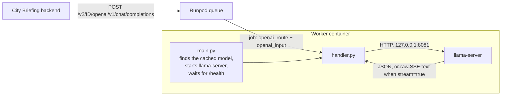

# llama.cpp on Runpod Serverless

Two container images built on the upstream llama.cpp CUDA server (`ghcr.io/ggml-org/llama.cpp:server-cuda13`). Both serve the OpenAI-compatible API the app talks to (`LLM_BASE_URL=.../openai/v1`). The image needs a host with CUDA 13 support, so allow CUDA 13.0 or newer on the endpoint.

| Folder | Endpoint type | Status |
|---|---|---|
| [`queue-worker/`](queue-worker) | Queue-based | **Used.** Scales from zero. A small Python worker (`main.py` starts `llama-server` and waits for `/health`, then registers with the queue; `handler.py` forwards each job to it). |
| [`ping-proxy/`](ping-proxy) | Load-balancing | Experiment. nginx answers `/ping` (200 once the model is loaded, 204 while loading) in front of `llama-server`. It served requests but did not start a worker from zero when a request arrived, so it needs a minimum of one worker. |

## How a request flows (queue-worker)



The Model field names the model once; Runpod downloads it to the host's model cache before the worker starts, and `main.py` points `llama-server` at the cached `.gguf` file.

## queue-worker

```bash
docker build -t <registry-user>/llama-cpp-queue:v1 queue-worker
docker push <registry-user>/llama-cpp-queue:v1
```

Create a template from the image (leave the container start command empty) and a queue endpoint from the template, then set the endpoint's **Model** field to the Hugging Face repo to serve, for example `https://huggingface.co/lmstudio-community/Qwen2.5-7B-Instruct-GGUF:main`. That field is the only place the model is named: Runpod downloads it to the host's model cache before the worker starts, and the worker runs the cached `.gguf` file directly (the model loads in a couple of seconds instead of being downloaded on every cold start). If the cached repo holds several quantizations, `LLAMA_QUANT` (default `Q4_K_M`) picks one. Typical settings: min workers 0 (scales to zero), max workers 1, idle timeout 60s, and optionally an execution timeout (for example 120-180s) so a stuck generation cannot keep a GPU billed.

If there is no cached model the worker waits for one (up to `CACHE_WAIT`), then exits with "no model" and a log line listing the cache contents and model-related variable names (never values), rather than serving with none. For local runs, or to override the cache, pass `llama-server` arguments as the container start command, for example `-hf <org>/<repo>:<quant> -c 8192 -ngl 99` (an explicit `-m` or `-hf` always wins; a cached `-hf` repo is used from the cache instead of downloaded).

### Environment variables

All optional.

| Var | Default | Notes |
|---|---|---|
| `LLAMA_QUANT` | `Q4_K_M` | Picks one file when the cached repo holds several quantizations |
| `CACHE_WAIT` | `300` | Seconds to wait for the cached model before giving up |
| `HF_CACHE_DIR` | `/runpod-volume/huggingface-cache/hub` | Where Runpod puts the Model field's repo (Hugging Face cache layout) |
| `LLAMA_PORT` | `8081` | Local port of `llama-server` (bound to 127.0.0.1 only) |
| `LLAMA_SERVER_BIN` | `/app/llama-server` | Path of the server binary in the image |
| `STARTUP_TIMEOUT` | `1800` | Seconds to wait for `llama-server` to become healthy before the worker exits |
| `MAX_CONCURRENCY` | `4` | Jobs a worker takes at once; matches `llama-server`'s default of 4 slots |
| `REQUEST_TIMEOUT` | `3600` | Seconds the handler waits on one `llama-server` request |

### Cost, limits and failures

There is no free tier: Serverless bills per second of GPU time while a worker is up, and nothing while the endpoint is scaled to zero. A cold start from zero takes about a minute on a host that already has the image and up to a few minutes when the host first has to pull it (the image is about 4 GB). The calling app waits for that (`LLM_TIMEOUT_MS`) and shows its data without the answer if the wait runs out.

| Situation | Behaviour |
|---|---|
| No model in the cache and none given | Waits up to `CACHE_WAIT`, then exits with a message and the cache contents |
| `llama-server` exits or never becomes healthy | The worker exits (immediately, or after `STARTUP_TIMEOUT`); it registers with the queue only once the model is loaded |
| `llama-server` answers with an error status | The job returns `{"error": {"status": ..., "message": ...}}` (message cut to 500 characters) |
| `llama-server` unreachable during a job | The job returns `{"error": "Request to llama-server failed: ..."}` |
| Unrecognised job input | The job returns an error saying which fields are accepted (`openai_input`, `openai_route`, `messages` or `prompt`) |

Streaming jobs (`"stream": true`) pass the raw server-sent-event text through; other jobs return the JSON reply.

### Tests

No GPU needed. The handler test runs inside the image against a stub server; the cache test runs anywhere. From this folder:

```bash
python3 queue-worker/test/test_cache.py
docker run --rm --entrypoint /opt/venv/bin/python -v $PWD/queue-worker/test:/test <image> /test/test_handler.py
```

## ping-proxy

```bash
docker build -t <registry-user>/llama-cpp-ping:v1 ping-proxy
```

Set the load-balancing endpoint's health check to `/ping` and pass the same `llama-server` arguments as above, including the model (this image has no model cache support). The endpoint needs `PORT=8080` and `PORT_HEALTH=8080`, with HTTP port 8080 exposed.
